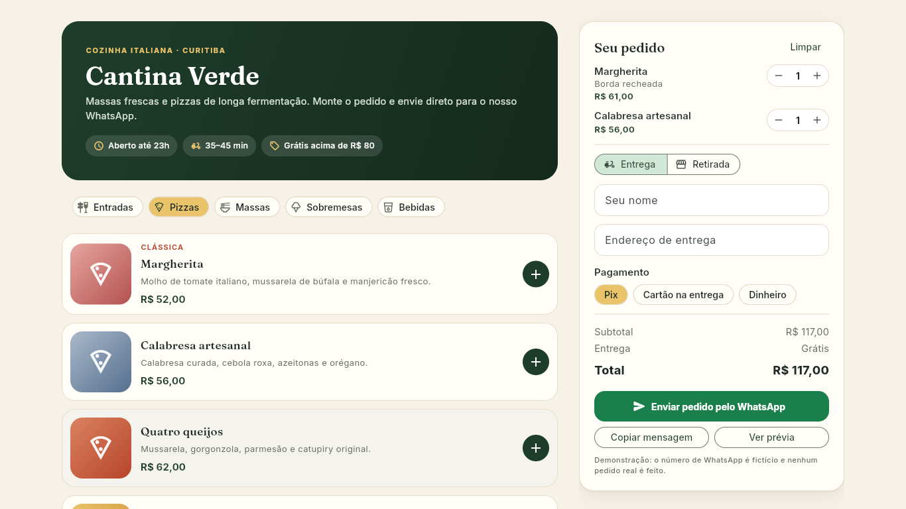
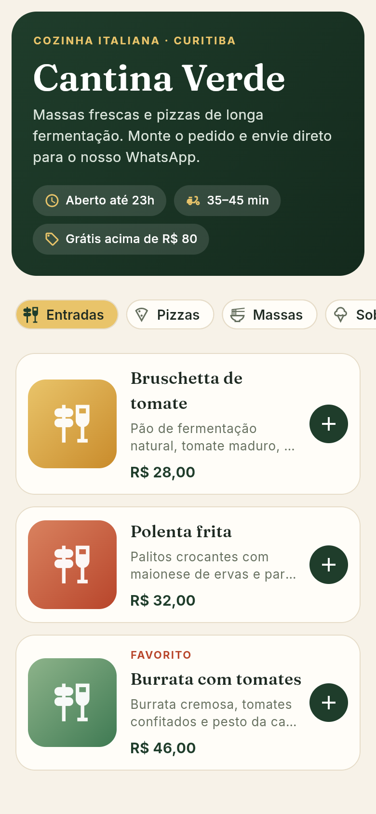
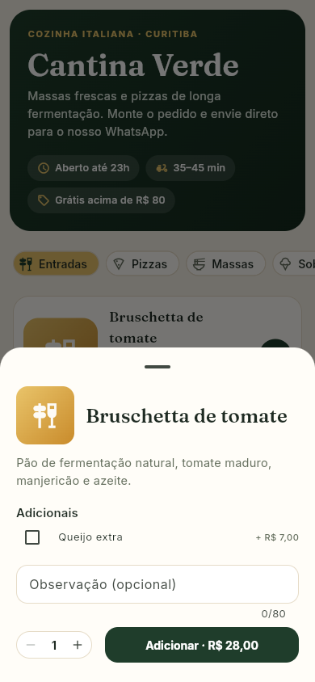

# Cantina Verde — digital menu with WhatsApp ordering

A restaurant menu demo built with **Flutter Web (Dart)**: browse by category, customise dishes with add-ons, review the cart and send the order as a ready-made WhatsApp message. The restaurant, prices and phone number are fictional; nothing is stored or sent anywhere except the `wa.me` link you click.

**Live demo:** https://alissonlittig.github.io/cantina-verde/



 

## Features

- 16 dishes in 5 categories, sticky category chips, illustrated tiles (no stock photos).
- Dish sheet with optional add-ons (extra price per add-on), free-text note and quantity.
- Cart merges identical lines (same dish + add-ons + note), live subtotal, delivery fee (free above R$ 80) and minimum order (R$ 25).
- Checkout: delivery or pickup, name, address, payment (Pix / card / cash with change), validation messages.
- Builds the order message (items, add-ons, notes, totals, payment) and opens `wa.me/<number>?text=...`; also "copy message" and an in-page preview.
- Responsive: bottom cart bar and sheet on phones (works from 390px, no horizontal scroll), two-column layout with a sticky order panel on desktop.

## Stack

Flutter 3 / Dart 3, Material 3 with a custom theme, `ChangeNotifier` for the cart (no state-management package), `url_launcher`, bundled Fraunces + Inter fonts, `flutter_test`, GitHub Actions + GitHub Pages.

## Decisions

- **Money in integer cents** (`brl()` formats) — no floating point.
- **Business rules outside widgets:** `lib/cart.dart` holds totals, delivery fee, validation and message building as plain Dart, covered by unit tests in `test/cart_test.dart`; `test/widget_test.dart` drives the add-to-cart and checkout-validation flows at 390px.
- **Cart as a single `ChangeNotifier`** listened with `ListenableBuilder`; for an app this size a package like Provider or Riverpod would be extra weight.
- **Mobile sheets, desktop panel:** the same `CheckoutPanel` widget is reused inline on wide screens and in a bottom sheet on phones.

## Run it

```bash
flutter pub get
flutter analyze
flutter test
flutter run -d chrome
flutter build web --release --base-href /cantina-verde/
```

CI (`.github/workflows/ci.yml`) runs analyze, tests and the web build on every push and deploys `build/web` to GitHub Pages from `main`.
